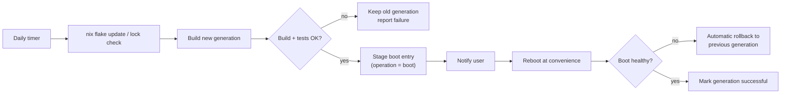

# Stability and updates

> **Status:** Mixed
> **Last updated:** 2026-11-18
> **See also:** [Release and support](13-release-and-support.md), [Security defaults](04-security-defaults.md), [Architecture](02-architecture.md)

Rix promises that a normal day of use does not break the machine, and that a
bad change can be undone in seconds. This document defines the update and
rollback model that delivers that promise.

## What NixOS already provides

- Each `nixos-rebuild` creates a **new system generation** with its own boot
  entry; the previous generation remains available.
- The Nix store is content-addressed and read-only; a rebuild builds a complete
  new closure instead of mutating files in place.
- Garbage collection removes unreferenced generations explicitly.
- `nixos-rebuild switch --rollback` and the boot menu provide recovery paths.
- `system.autoUpgrade` exists in nixpkgs and is disabled by default; Rix turns
  it on with a controlled policy.

## Update policy (Design)

| Policy | Value |
| --- | --- |
| Channel | Track the Rix release branch pinned to a stable `nixos-<release>` (currently `nixos-26.05`). |
| Default behaviour | Check for updates daily; download and build them automatically; apply at next boot. |
| User notification | Clear notification: "Updates ready — restart to apply", with a one-click reboot. |
| Within-release updates | Automatic, including security fixes. |
| Major release upgrades | Opt-in, with release notes and a pre-upgrade check. |
| Rollback | Always available from the boot menu and from Rix Settings; automatic on failed boot. |
| Pause control | User can pause, schedule or switch to manual updates in the GUI. |
| Generation retention | Keep at least the last 10 successful generations and anything younger than 30 days. |
| Garbage collection | Automatic, but never removes a generation still referenced by a boot entry or within the retention window. |

Why apply at next boot: it avoids restarting services under an actively used
desktop and makes the change atomic from the user's perspective. Security
urgency is handled by shortening the reboot prompt, not by forcing an
interruption.

## Update flow

## Health checks and automatic rollback

A generation is marked successful only after the desktop session starts and a
small set of health checks pass (key services active, no crash loop on critical
units, disk readable). If the machine fails to reach that state within a
configured window after an update boot, the bootloader falls back to the last
known-good generation and Rix Settings shows a plain-language report.

This is intentionally conservative: a false rollback is annoying, a missed
failed update can strand a non-technical user.

## Testing before an update is offered

| Stage | Check |
| --- | --- |
| Flake evaluation | `nix flake check`-style evaluation of all supported systems. |
| Patch integrity | `patch --dry-run` of the Calamares branding patch against the pinned nixpkgs. |
| VM smoke test | ISO boots; Calamares starts; Plasma session reaches the desktop. |
| Encryption test | LUKS unlock with passphrase and recovery key. |
| Critical services | Firewall active, login service healthy, GUI settings service healthy. |
| aarch64 | Build and boot test on ARM hardware or emulation. |
| Artifact integrity | Checksums published; signed artifacts planned. |

See [`13-release-and-support.md`](13-release-and-support.md) for how these fit
into a release.

## Configuration stability rules

1. Rix module option names are part of the public interface for a release;
   renames require a compatibility alias for the whole support window.
2. The GUI settings schema is versioned. Upgrades migrate old settings rather
   than discarding them.
3. Generated `configuration.nix` must remain readable and valid Nix; users may
   take over and edit it at any time.
4. A rebuild never relies on network access to complete once inputs are in the
   store, so updates work on flaky connections.
5. If an update fails partway, the previous generation is untouched.

## Failure modes

| Failure | Behaviour |
| --- | --- |
| No network | Timer retries later; current system unaffected. |
| Build failure | Old generation stays active; notification with a link to logs. |
| Disk full | Garbage collection is attempted only outside the retention window; otherwise alert, do not delete user data. |
| Corrupt new generation | Boot entry is ignored; previous generation boots. |
| User edits generated Nix | GUI warns that manual edits may be overwritten and offers to import them into a module. |

## Relationship to security

Automatic updates are a security control, not a convenience: they close the
window between a fix being available and a user applying it. That is why the
default is on, with rollback as the safety net rather than manual action as the
default. See [`03-threat-model.md`](03-threat-model.md), scenario 6.
